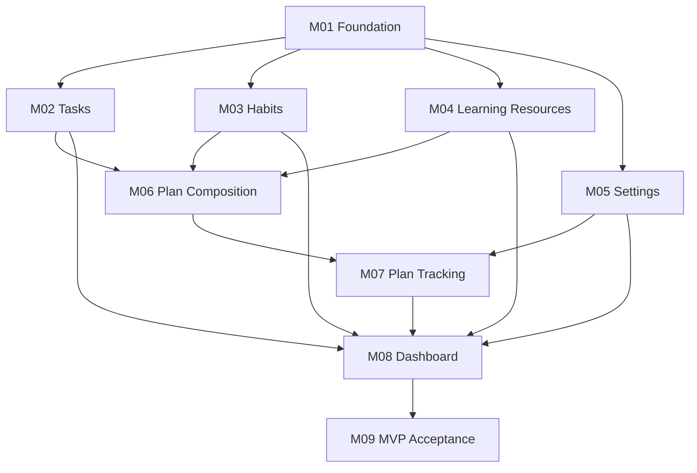
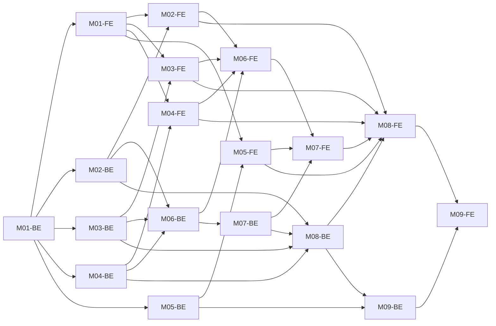

# Dependency Graph and Execution Plan

| Field | Value |
|---|---|
| Source | `requirements/PRD.md` |
| Generated | 2026-10-10 |
| Module specs | `outputs/modules/` |
| Handoffs (created later by backend loop) | `outputs/handoffs/<ID>-<slug>-handoff.md` |

---

## 1. Modules

| ID | Module | Type | Spec |
|---|---|---|---|
| M01 | Foundation — Platform & App Shell | Foundation | [M01-foundation.md](modules/M01-foundation.md) |
| M02 | Tasks | Feature | [M02-tasks.md](modules/M02-tasks.md) |
| M03 | Habits | Feature | [M03-habits.md](modules/M03-habits.md) |
| M04 | Learning Resources | Feature | [M04-learning-resources.md](modules/M04-learning-resources.md) |
| M05 | Settings | Feature | [M05-settings.md](modules/M05-settings.md) |
| M06 | Plan Composition (Todo Plans — builder, items, progress %) | Feature | [M06-plan-composition.md](modules/M06-plan-composition.md) |
| M07 | Plan Tracking (Todo Plans — lifecycle, rest time, notifications, history) | Feature | [M07-plan-tracking.md](modules/M07-plan-tracking.md) |
| M08 | Dashboard | Feature | [M08-dashboard.md](modules/M08-dashboard.md) |
| M09 | MVP Acceptance & End-to-End Verification | Verification | [M09-mvp-acceptance.md](modules/M09-mvp-acceptance.md) |

**Why Foundation is its own module:** both projects are empty. Without M01, every feature module would scaffold the projects, DbContext, error handling and navigation in parallel and collide.

**Why Todo Plans is split in two:** M06 holds the deterministic composition and item logic. M07 holds the clock-driven lifecycle, rest time and notifications. Splitting keeps each verification unit small, isolates the hard-to-test time logic (TR-2), and lets M06-FE overlap with M07-BE.

---

## 2. Module-Level Dependency Graph

`A --> B` means **B depends on A**.



```text
                    ┌──────────────┐
                    │ M01 Foundation│
                    └──────┬───────┘
         ┌─────────┬───────┼──────────┬──────────┐
         ▼         ▼       ▼          ▼          │
      M02 Tasks  M03 Habits  M04 Learning   M05 Settings
         │         │       │          │
         └────┬────┴───────┘          │
              ▼                       │
     M06 Plan Composition             │
              │                       │
              ▼                       │
     M07 Plan Tracking ◄──────────────┤
              │                       │
              ▼                       │
       M08 Dashboard ◄────────────────┘   (also ← M02, M03, M04)
              │
              ▼
     M09 MVP Acceptance
```

| Module | Depends on | Reason |
|---|---|---|
| M01 | — | Root: projects, persistence, conventions, nav shell |
| M02 | M01 | Uses project skeleton, DB, error format, shell route |
| M03 | M01 | Same |
| M04 | M01 | Same |
| M05 | M01 | Same |
| M06 | M02, M03, M04 | Plan items reference tasks/habits/cards (BR-10). BR-13 reuses task completion logic |
| M07 | M06, M05 | Lifecycle builds on plans/items. Start notifications honor the notification preference |
| M08 | M02, M03, M04, M05, M07 | Aggregates every feature. Greeting uses display name. Active plans need rest time/status (M06 transitively) |
| M09 | M08 (→ all) | Cross-module E2E and DoD sign-off |

---

## 3. Layer-Level Dependencies (what the scheduler actually checks)

The orchestrator schedules backend (BE) and frontend (FE) separately. A layer is `READY` only when every entry in its list is `COMPLETED` (for BE dependencies, this includes verification; for FE dependencies, the handoff must also be `READY`).

| Layer | Required dependencies |
|---|---|
| M01-BE | — |
| M01-FE | M01-BE |
| M02-BE | M01-BE |
| M02-FE | M02-BE, M01-FE |
| M03-BE | M01-BE |
| M03-FE | M03-BE, M01-FE |
| M04-BE | M01-BE |
| M04-FE | M04-BE, M01-FE |
| M05-BE | M01-BE |
| M05-FE | M05-BE, M01-FE |
| M06-BE | M02-BE, M03-BE, M04-BE |
| M06-FE | M06-BE, M02-FE, M03-FE, M04-FE *(reuses their API services/types in the item picker)* |
| M07-BE | M06-BE |
| M07-FE | M07-BE, M06-FE, M05-FE *(notification preference)* |
| M08-BE | M02-BE, M03-BE, M04-BE, M07-BE |
| M08-FE | M08-BE, M02-FE, M03-FE, M04-FE, M05-FE, M07-FE *(reuses rows, toggles, rest-time widget, create dialogs)* |
| M09-BE | M01-BE … M08-BE (all) |
| M09-FE | M09-BE, M01-FE … M08-FE (all) |



---

## 4. Execution Waves (theoretical, unlimited parallelism)

| Wave | Layers that become READY |
|---|---|
| 1 | M01-BE |
| 2 | M01-FE · M02-BE · M03-BE · M04-BE · M05-BE |
| 3 | M02-FE · M03-FE · M04-FE · M05-FE · M06-BE |
| 4 | M06-FE · M07-BE |
| 5 | M07-FE · M08-BE |
| 6 | M08-FE · M09-BE |
| 7 | M09-FE |

**Critical path (7 steps):** M01-BE → M02/M03/M04-BE → M06-BE → M07-BE → M08-BE → M08-FE → M09-FE (the FE chain M01-FE → M02/3/4-FE → M06-FE → M07-FE → M08-FE has the same length).

---

## 5. Recommended Schedule — Two Lanes

The workspace is not a git repository, and all backend modules share one project (DbContext, migrations, startup registration). Running several backend loops at once risks conflicting edits. **Recommendation:** one backend lane and one frontend lane running concurrently. They touch different projects, so they don't conflict.

| Slot | Backend lane | Frontend lane |
|---:|---|---|
| 1 | M01-BE | — |
| 2 | M02-BE | M01-FE |
| 3 | M03-BE | M02-FE |
| 4 | M04-BE | M03-FE |
| 5 | M06-BE *(critical path first)* | M04-FE |
| 6 | M05-BE | M06-FE |
| 7 | M07-BE | M05-FE |
| 8 | M08-BE | M07-FE |
| 9 | M09-BE | M08-FE |
| 10 | — | M09-FE |

**Sequential fallback (one loop at a time):** M01-BE, M01-FE, M02-BE, M02-FE, M03-BE, M03-FE, M04-BE, M04-FE, M05-BE, M05-FE, M06-BE, M06-FE, M07-BE, M07-FE, M08-BE, M08-FE, M09-BE, M09-FE.

The scheduler should always re-check §3 after any layer changes state. The tables above are the expected outcome, not a fixed script.

---

## 6. Scheduling Rules Applied

1. Initial state: M01-BE = `READY`. Every other layer = `WAITING`.
2. A BE layer moves to `READY` when every BE dependency in §3 is `COMPLETED`.
3. A FE layer moves to `READY` when its own BE is `COMPLETED`, its handoff file exists with status `READY`, and every FE dependency in §3 is `COMPLETED`.
4. A module is `COMPLETED` when both its BE and FE layers are `COMPLETED`.
5. A layer that fails 3 attempts becomes `BLOCKED`. Every layer that depends on it, directly or transitively, stays `WAITING` and is reported as blocked-by-dependency. Independent layers keep running.
6. After every state change: update `progress.md` and `state/current-state.md`, then re-evaluate §3.

---

## 7. Handoff Convention

When a BE layer completes, the backend loop writes:

`loops/orchestrator/outputs/handoffs/<ID>-<slug>-handoff.md`

| Module | Handoff file |
|---|---|
| M01 | `M01-foundation-handoff.md` |
| M02 | `M02-tasks-handoff.md` |
| M03 | `M03-habits-handoff.md` |
| M04 | `M04-learning-resources-handoff.md` |
| M05 | `M05-settings-handoff.md` |
| M06 | `M06-plan-composition-handoff.md` |
| M07 | `M07-plan-tracking-handoff.md` |
| M08 | `M08-dashboard-handoff.md` |
| M09 | `M09-mvp-acceptance-handoff.md` |

Required header line: `Handoff Status: READY`. Contents follow backend-dev Loop-instructions §12: endpoints, methods, request/response models, validation rules, UI-relevant business rules and error responses.
